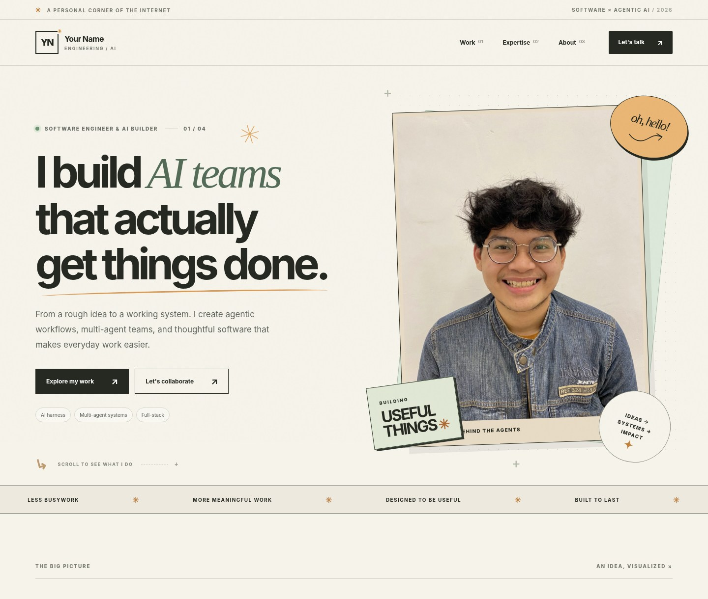
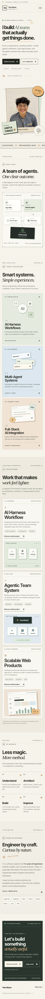
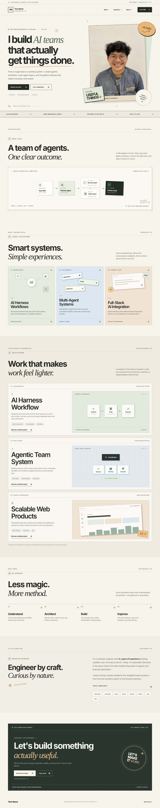

# Personal Portfolio — Design and Build Plan

> Historical plan: the September 25 scrapbook redesign supersedes this visual direction. See [redesign.md](redesign.md) for the current references and implementation.

Status: implemented locally in Astro. Production build and responsive browser validation passed; public deployment has not been performed. See [validation.md](validation.md) for results and the repository README for editing and deployment instructions.

## Goal

Build a personal portfolio hosted on GitHub Pages that introduces the owner, demonstrates their work, and makes it easy to get in touch. Use the three supplied screenshots as the visual reference for a warm, editorial portfolio focused on software engineering and AI systems.

The repository was empty when this plan was written. This document records the first version's design direction and implementation sequence.

## Reference direction

### Original reference images

#### Image 1 — Desktop hero



#### Image 2 — Mobile full page



#### Image 3 — Desktop full page



### How to use the references

- **Image 1:** desktop hero detail, typography, portrait treatment, navigation, and decorative accents.
- **Image 2:** mobile section order and single-column layout.
- **Image 3:** complete desktop page composition, spacing, project layouts, and contact section.

Preserve the references' personality: cream paper, dark ink, sage green, fine rules, oversized typography, and a playful portrait collage. Adapt the content to the owner's real experience rather than copying the sample identity, claims, or projects.

### Visual system

| Element | Proposed treatment |
| --- | --- |
| Background | Warm ivory, approximately `#F6F3E9`; alternating sections in slightly deeper cream |
| Primary text | Near-black olive, approximately `#252920` |
| Secondary text | Muted gray-green, approximately `#6E7368` |
| Accents | Sage `#637965`, pale green `#E2E9DC`, powder blue `#DFEAF0`, sand `#EEE1CF`, warm ochre `#D29B58` |
| Typography | Bold sans-serif headlines paired with expressive italic serif phrases; candidate pairing: locally hosted Manrope and Instrument Serif |
| Small labels | Uppercase, generously tracked section labels and understated numbering |
| Layout | Broad margins, generous vertical spacing, thin borders, mostly square corners |
| Illustration | Lightweight SVG or HTML diagrams, dotted grids, arrows, and small starbursts |
| Portrait | Slightly rotated paper frame with layered backing sheets and a small greeting sticker |
| Motion | Subtle entrance and hover transitions; honor reduced-motion preferences |

Treat these colors and fonts as starting choices to validate against the references and accessibility requirements. Keep textures faint so they never interfere with reading. Use decorative overlaps selectively, particularly on smaller screens.

## Page structure

### 1. Masthead and navigation

- Narrow top strip with a short personal descriptor and discipline label.
- Monogram, real display name, and concise professional title.
- Links to Work, Expertise, About, and Contact.
- On mobile, an accessible menu button with explicit open/closed state and keyboard support.

### 2. Hero

- Desktop: text on the left and portrait collage on the right.
- Large headline mixing bold sans-serif and italic serif emphasis. Working copy: “I build useful software that makes work easier.” Refine once the owner's positioning is confirmed.
- Short introduction explaining what the owner builds and for whom.
- Primary action: “Explore my work,” linking to selected projects.
- Secondary action: “Let's collaborate,” linking to contact.
- Up to three specialty tags based on actual skills.
- Small scroll cue and a static values strip beneath the hero.
- Mobile: headline, description, actions, and tags followed by the portrait; maintain readable type and comfortable spacing.

### 3. The big picture

- Reference-inspired headline: “A team of agents. One clear outcome.” Use only if agent systems reflect the owner's work.
- A simple diagram showing an idea moving through planning, research/building, and a useful result, with a human checkpoint.
- A short plain-language explanation and equivalent accessible text for the diagram.
- Present this as an explanation of an approach, not evidence of a shipped project.

### 4. Expertise

- Three illustrated cards with a title, short explanation, and practical examples.
- Proposed themes: AI workflows, multi-agent systems, and full-stack integration; confirm against real experience.
- Desktop: three columns. Mobile: stacked cards.
- If cards link anywhere, the destination must contain meaningful related content.

### 5. Selected work

- Aim for three real projects; show fewer if only fewer are ready.
- Desktop: horizontal project rows with the description beside a visual. Mobile: stacked content and visual.
- Each entry includes project name, problem, personal contribution, tools, and an honest result.
- Add repository and live-demo links when available; clearly label private work and conceptual illustrations.
- Prefer actual screenshots or project-specific diagrams over generic dashboard mockups.
- Do not publish invented metrics, customers, employment history, or projects.

### 6. Process

- Four concise steps: Understand, Architect, Build, Improve.
- One practical sentence per step, emphasizing delivery and iteration.
- Four columns on wide screens, two where space allows, and one on narrow screens.

### 7. About

- Short biography in the reference's two-column editorial arrangement.
- Include real interests, engineering approach, and a compact set of tools used.
- Optional résumé link only when a current file is provided.
- Avoid unsupported experience-duration or availability claims.

### 8. Contact and footer

- Large dark-green contact panel with ivory text and italic ochre emphasis.
- “Send an email” link and “Copy email” button with accessible success/failure feedback.
- GitHub and other supplied professional profile links.
- Small footer with name, year, and “Back to top.”
- Use direct contact links for the first version; a contact form would require a separate service.

## Proposed implementation

Use **Astro with TypeScript and plain CSS** to generate a static site. This is a proposal for the implementation phase, chosen because the portfolio is primarily content and needs only small interactive enhancements.

- Semantic HTML and reusable section components.
- Central CSS variables for colors, type scale, spacing, borders, and motion.
- Typed content files for profile information, skills, projects, and links.
- Local portrait, project images, SVG illustrations, and licensed font files.
- Minimal client-side JavaScript for the mobile menu and copy-email interaction.
- No backend, database, account system, or client-side router required for version one.

Suggested structure:

```text
docs/
  portfolio-plan.md
public/
  fonts/
  images/
  favicon.svg
src/
  components/
  content/
    profile.ts
    projects.ts
  layouts/
    BaseLayout.astro
  pages/
    index.astro
  styles/
    global.css
.github/
  workflows/
    deploy.yml
astro.config.mjs
package.json
README.md
```

### GitHub Pages delivery

- Confirm the repository owner, repository name, and intended public URL before configuring deployment.
- Account for both an account site (`https://<owner>.github.io/`) and a project site (`https://<owner>.github.io/<repository>/`).
- Configure the site's canonical URL and base path; ensure images, fonts, internal links, and metadata work under that path.
- Use GitHub Actions to install locked dependencies, validate the project, build the static output, and deploy the generated artifact to Pages.
- Validate pull requests without deploying them; deploy from the repository's actual default branch.
- Verify current official Astro and GitHub Pages instructions during implementation before choosing versions and workflow configuration.
- Leave a custom domain as an optional later step.

## Content and assets needed

These details can be collected before implementation; they do not block writing this plan:

- Preferred public name, monogram, professional title, and short biography.
- Original portrait file approved for public use. Do not extract and reuse the reference person's portrait by default.
- Two or three project summaries with repository/demo links, contribution details, and screenshots where available.
- Confirmed specialties and tools.
- Public contact email, GitHub profile, and optional LinkedIn or résumé.
- Intended GitHub Pages URL and optional custom domain.

Use clearly marked draft content during local development. Remove or replace all placeholders before launch.

## Implementation milestones

1. **Content and foundation:** confirm positioning and assets; scaffold the static project; establish tokens, typography, and content types.
2. **Hero and navigation:** build the masthead, responsive menu, headline, portrait collage, actions, and values strip. Review this first because it sets the visual direction.
3. **Main sections:** build the explanatory diagram, expertise cards, project rows, process, about, and contact panel.
4. **Responsive and accessibility pass:** refine spacing, text wrapping, diagrams, keyboard behavior, focus states, and reduced motion.
5. **Production preparation:** optimize media and fonts; add metadata, favicon, social preview, deployment workflow, and editing instructions.
6. **Validation and launch:** run checks, compare desktop/mobile screenshots to the references, verify the Pages base path, deploy, and inspect the public site.

## Acceptance checklist

- [ ] Overall hierarchy, paper palette, mixed typography, portrait collage, and section rhythm reflect the supplied references.
- [ ] Layout works at 360, 390, 768, 1024, and 1440 pixels without unintended horizontal scrolling.
- [ ] Mobile layouts are intentionally composed rather than scaled-down desktop screenshots.
- [ ] All navigation, project links, contact actions, and optional résumé links work.
- [ ] Menu and copy-email interactions work with keyboard input and expose useful state/feedback.
- [ ] Semantic landmarks, heading hierarchy, skip link, descriptive link labels, and meaningful image alternatives are present.
- [ ] Decorative elements are hidden from assistive technology; diagrams have a readable equivalent.
- [ ] Text contrast meets WCAG AA, focus is visible, and reduced-motion preferences are respected.
- [ ] Portrait and project images use appropriate sizes and reserved dimensions to avoid layout shifts; below-fold images load lazily.
- [ ] Type checks and production build pass; interaction tests cover meaningful menu and clipboard behavior.
- [ ] Production preview is checked for broken assets, browser errors, and base-path problems.
- [ ] Page title, description, canonical URL, social preview, and favicon use the actual portfolio identity.
- [ ] No draft copy, sample identity, invented claims, or dead placeholder links remain at launch.
- [ ] README explains local development, content editing, builds, and GitHub Pages deployment.

## Deferred from version one

Blog, CMS, theme switching, analytics, advanced animation, and a backend contact form. Add them later only if they serve a concrete need.
