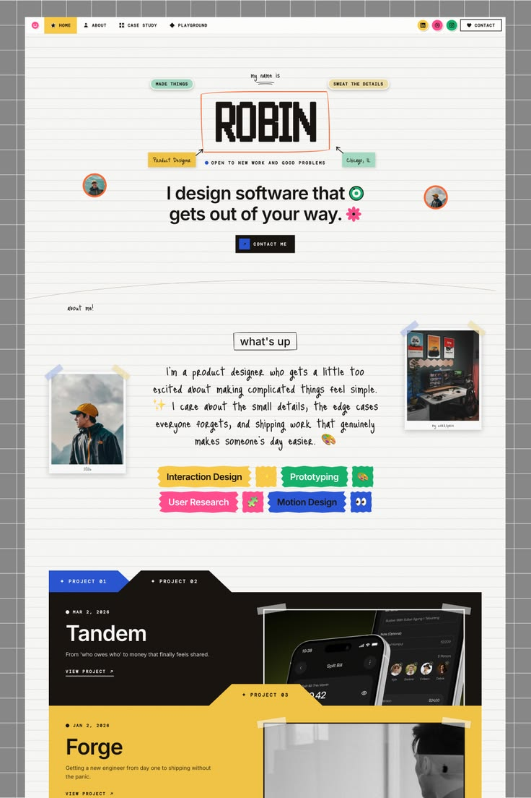
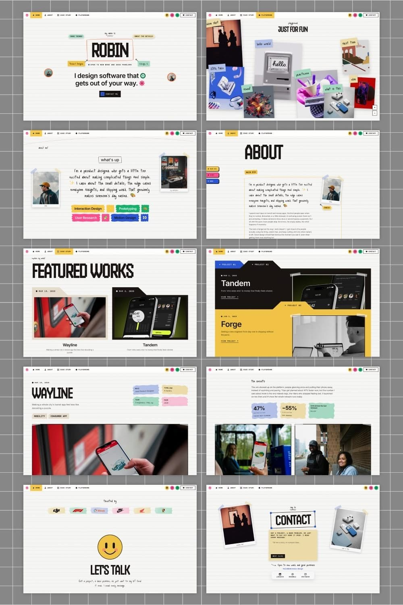

# Scrapbook portfolio redesign

September 25, 2026. This supersedes the visual direction in the original portfolio plan.

## References supplied by the user

### Home page

### Full page family

## Implemented direction

Gray graph-paper backdrop, off-white ruled paper, oversized blocky name, orange outline, handwritten notes, taped portrait and inspiration photographs, saturated skill stickers, and stacked project folders. Dedicated About, Work, project detail, Playground, and Contact pages share the same compact navigation.

The owner's confirmed display name, portrait, public GitHub account, and repositories are preserved. The reference's Robin identity, unrelated project names, client logos, and outcome metrics are not reused.

## Interaction details

- Home project tabs navigate to the matching folder; project links open real detail pages.
- About section labels navigate within the biography.
- Playground filters select code or visual entries, shuffle rearranges the collection, and native disclosures expand individual notes.
- Contact links to the public profile, with a copy action and clear success/failure feedback. Adding an email to the profile data switches the contact actions to email.
- The responsive menu reports its state and supports Escape.
- Motion is brief, user-triggered where appropriate, and respects reduced-motion preferences.

## Delivery

Eight static pages built with the existing Astro stack. GitHub Pages configuration remains under `/rayandika/`. No push or deployment performed. See [validation.md](validation.md) for checks and [asset-sources.md](asset-sources.md) for image provenance.
